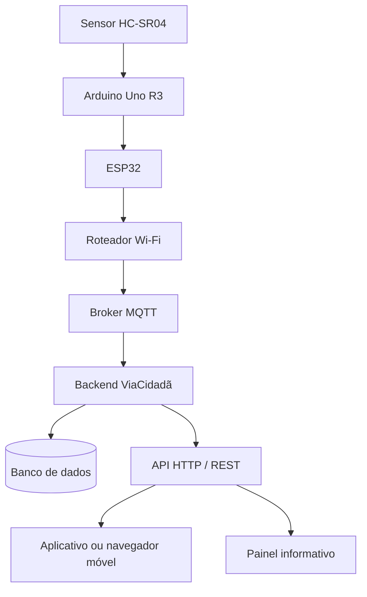

# ViaCidadã — IoT e Redes

## 1. Identificação do projeto

**Projeto:** ViaCidadã  
**Disciplina:** IoT e Redes  
**Global Solution:** 2026/2  
**Dispositivo demonstrativo:** VC-001  
**Local monitorado:** Terminal Santana  
**Tipo de transporte:** Ônibus

### Integrantes

| Integrante | RM |
|---|---:|
| Alisson Kawan | 567598 |
| Eduardo Boni | 567236 |
| Erick Ramos | 567837 |
| Kenji Fernandes | 568156 |
| Marcos Vinicius | 567214 |

---

## 2. Visão geral da solução

O ViaCidadã é uma proposta CitizenTech voltada à melhoria da experiência dos usuários do transporte público. A solução busca oferecer informações que auxiliem os passageiros no planejamento de seus deslocamentos, considerando a disponibilidade do transporte, as condições de acesso e possíveis ocorrências durante a viagem.

Na área de IoT, o projeto propõe um dispositivo capaz de monitorar a presença de veículos em pontos de transporte, utilizando sensores para identificar objetos dentro de uma distância configurada.

O protótipo demonstrativo utiliza um Arduino Uno R3 e um sensor ultrassônico HC-SR04. O circuito realiza leituras de distância, interpreta os resultados e informa o estado identificado por meio de LEDs e mensagens no Monitor Serial.

A arquitetura também prevê a comunicação dos dispositivos com a plataforma ViaCidadã por meio de uma conexão de rede, permitindo que as informações coletadas sejam utilizadas em serviços digitais destinados aos passageiros.

---

## 3. Problema identificado e proposta CitizenTech

A falta de informações atualizadas sobre a circulação e a disponibilidade do transporte público pode dificultar o planejamento dos passageiros.

Em determinadas situações, o usuário pode permanecer aguardando um ônibus sem saber se o veículo está próximo, se houve alguma alteração na operação ou se seria mais vantajoso utilizar outra linha.

A proposta do ViaCidadã é utilizar dispositivos IoT para coletar informações em pontos estratégicos do transporte público e disponibilizá-las de maneira organizada.

Com isso, os dados de monitoramento podem auxiliar na identificação de situações incomuns, na comunicação de alertas e na apresentação de alternativas de deslocamento.

---

## 4. Funcionamento do protótipo

O protótipo utiliza um sensor ultrassônico HC-SR04 para medir a distância entre o sensor e um objeto localizado à sua frente.

O Arduino recebe a medição e compara o resultado com um limite de distância configurado em 250 centímetros.

A partir dessa comparação, o sistema determina o estado de presença:

- **PRESENTE:** objeto detectado a uma distância igual ou inferior a 250 cm.
- **AUSENTE:** objeto não detectado dentro do limite configurado ou ausência de uma leitura válida.

O resultado também controla os LEDs:

| Estado | LED verde | LED vermelho |
|---|---|---|
| Presença detectada | Aceso | Apagado |
| Ausência detectada | Apagado | Aceso |

O dispositivo possui identificação e parâmetros configuráveis no código:

| Parâmetro | Valor demonstrativo |
|---|---|
| Identificação | VC-001 |
| Parada | Terminal Santana |
| Transporte | ONIBUS |
| Distância limite | 250 cm |
| Intervalo periódico | 60 segundos |

O mesmo circuito pode ser reutilizado para monitorar diferentes pontos de transporte. Para isso, basta alterar a identificação da parada e o tipo de transporte nas configurações do código.

### Política de atualização

O dispositivo disponibiliza uma atualização nas seguintes situações:

1. Na primeira leitura após a inicialização.
2. Quando ocorre uma mudança entre os estados PRESENTE e AUSENTE.
3. Periodicamente, a cada 60 segundos, mesmo quando o estado permanece igual.

Essa estratégia permite informar mudanças relevantes sem deixar de atualizar periodicamente a situação monitorada.

---

## 5. Componentes utilizados

| Componente | Quantidade | Função |
|---|---:|---|
| Arduino Uno R3 | 1 | Processamento das leituras e controle do circuito |
| Sensor ultrassônico HC-SR04 | 1 | Medição da distância |
| LED vermelho | 1 | Indicação de ausência |
| LED verde | 1 | Indicação de presença |
| Resistor de 220 Ω | 2 | Limitação de corrente dos LEDs |
| Protoboard | 1 | Montagem do circuito |
| Jumpers | Conforme necessário | Conexões elétricas |

### Ambiente de desenvolvimento

- Tinkercad Circuits: montagem e simulação do circuito.
- Editor de código do Arduino: desenvolvimento do programa.
- Monitor Serial: visualização das informações coletadas.

O código demonstrativo não utiliza bibliotecas externas.

---

## 6. Montagem e conexões do circuito

### Sensor HC-SR04

| Pino do sensor | Conexão no Arduino |
|---|---|
| VCC | 5V |
| TRIG | D2 |
| ECHO | D3 |
| GND | GND |

### LEDs

| Componente | Conexão |
|---|---|
| LED vermelho — anodo (+) | Pino D6, em série com resistor de 220 Ω |
| LED vermelho — catodo (-) | GND |
| LED verde — anodo (+) | Pino D7, em série com resistor de 220 Ω |
| LED verde — catodo (-) | GND |

Os resistores são utilizados para limitar a corrente elétrica e proteger os LEDs e as saídas do Arduino.

---

## 7. Estrutura das informações

O dispositivo apresenta as informações coletadas no Monitor Serial em formato descritivo e também em uma estrutura JSON.

### Exemplo de saída

```json
{
  "dispositivo": "VC-001",
  "parada": "Terminal Santana",
  "transporte": "ONIBUS",
  "presenca": true,
  "distancia_cm": 185.40
}
```

Os campos representam:

| Campo | Descrição |
|---|---|
| dispositivo | Identificação do equipamento |
| parada | Nome do ponto monitorado |
| transporte | Tipo de transporte associado |
| presenca | Estado identificado pelo sensor |
| distancia_cm | Distância medida em centímetros |

Quando não existe uma leitura válida, o campo `distancia_cm` recebe `null` e o estado de presença é informado como `false`.

Essa estrutura facilita a integração dos dados com outros componentes de software e serviços de comunicação.

---

## 8. Arquitetura de comunicação em rede

A arquitetura proposta conecta o dispositivo de monitoramento à plataforma ViaCidadã, permitindo que as informações coletadas sejam encaminhadas para processamento e disponibilização aos usuários.

### Fluxo de comunicação



### Dispositivos e componentes da arquitetura

**Arduino Uno R3**

Realiza a leitura do sensor, processa a distância e determina o estado de presença do objeto monitorado.

**ESP32**

Atua como módulo de comunicação, recebendo as informações do Arduino e transmitindo os dados por Wi-Fi.

**Roteador Wi-Fi**

Fornece a conexão de rede necessária para encaminhar as mensagens até o serviço de comunicação.

**Broker MQTT**

Recebe e distribui as mensagens publicadas pelos dispositivos IoT, utilizando tópicos que organizam as informações por transporte e localização.

**Backend ViaCidadã**

Recebe os dados, interpreta os estados monitorados e organiza as informações utilizadas pelas funcionalidades da plataforma.

**Banco de dados**

Armazena informações necessárias para consultas, histórico de monitoramento e processamento de ocorrências.

**API HTTP/REST**

Disponibiliza os dados organizados para as interfaces que apresentam informações aos passageiros.

### Comunicação entre Arduino e ESP32

A comunicação entre o Arduino Uno e o ESP32 pode ser realizada por UART, utilizando os pinos de transmissão e recepção serial.

As conexões devem considerar:

- TX do Arduino conectado ao RX do ESP32.
- RX do Arduino conectado ao TX do ESP32.
- GND compartilhado entre os dispositivos.
- Adequação dos níveis de tensão do sinal.

O Arduino Uno utiliza lógica de 5V, enquanto o ESP32 trabalha com lógica de 3,3V. Portanto, o sinal transmitido pelo TX do Arduino para o RX do ESP32 deve passar por um divisor de tensão ou conversor de nível lógico.

### Comunicação Wi-Fi e MQTT

O ESP32 pode utilizar a rede Wi-Fi para estabelecer comunicação com um broker MQTT.

O dispositivo publica mensagens contendo a identificação da instalação, o tipo de transporte, o estado de presença e a distância medida.

Exemplo de tópico MQTT:

```text
viacidada/transporte/onibus/terminal-santana/status
```

A publicação permite que o backend receba atualizações do dispositivo e processe os estados monitorados.

Para uma implementação em ambiente real, a comunicação deve considerar autenticação, proteção das credenciais, conexão segura com TLS, reconexão automática e níveis de qualidade de serviço (QoS).

---

## 9. Aplicação prática: identificação de demora no transporte e recálculo de rota

Um exemplo de utilização do ViaCidadã pode ser observado na experiência de uma passageira que aguarda um ônibus no Terminal Santana.

Mariana está no terminal e acessa o ViaCidadã pelo navegador de seu celular para acompanhar as condições do transporte público e planejar seu deslocamento.

Ao consultar o ponto monitorado, ela visualiza que o ônibus associado à parada está sendo identificado como ausente há 18 minutos. Como esse período ultrapassa o intervalo esperado para a situação, a plataforma apresenta um alerta de possível demora ou indisponibilidade do transporte.

Na própria interface, Mariana pode consultar o estado do ponto e selecionar a opção **“Recalcular minha rota”**.

A plataforma apresenta alternativas de deslocamento até o destino informado, permitindo que ela compare outras possibilidades de transporte e escolha a opção mais conveniente.

### Fluxo da experiência

1. Mariana acessa o ViaCidadã pelo navegador do celular.
2. Consulta a situação do transporte no Terminal Santana.
3. Visualiza que o ônibus está indicado como ausente há 18 minutos.
4. Recebe um alerta de possível demora no atendimento.
5. Seleciona a opção “Recalcular minha rota”.
6. Visualiza alternativas de deslocamento até seu destino.
7. Escolhe uma nova opção para continuar sua viagem.

### Benefício para o passageiro

O monitoramento transforma uma informação técnica coletada por sensores em um dado útil para a tomada de decisão do usuário.

Em vez de apenas aguardar sem informações, o passageiro pode identificar uma situação atípica e avaliar alternativas para continuar seu deslocamento.

Esse exemplo demonstra como a integração entre IoT, comunicação em rede e serviços digitais pode contribuir para uma experiência de transporte público mais informada e acessível.

---

## 10. Execução e testes do protótipo

O circuito foi desenvolvido e simulado no Tinkercad Circuits, utilizando o Arduino Uno R3 e o sensor HC-SR04.

Os testes foram realizados com diferentes distâncias entre o sensor e o objeto, verificando o comportamento dos LEDs e das informações exibidas no Monitor Serial.

### Casos de teste

| Teste | Condição | Resultado esperado |
|---|---|---|
| T01 | Inicialização do circuito | Primeira leitura apresentada |
| T02 | Objeto a 265,91 cm | Estado AUSENTE |
| T03 | Objeto a 170,15 cm | Estado PRESENTE |
| T04 | Alteração entre presença e ausência | LEDs e informações atualizados |
| T05 | Estado sem alteração por 60 segundos | Nova atualização periódica |
| T06 | Emissão da estrutura JSON | Dados organizados para integração |

### Resultados observados

- A distância de 265,91 cm foi interpretada como AUSENTE.
- A distância de 170,15 cm foi interpretada como PRESENTE.
- Os LEDs acompanharam corretamente os estados identificados.
- As informações foram apresentadas no Monitor Serial.
- A atualização periódica ocorreu após 60 segundos, mesmo sem alteração do estado.

---

## 11. Evidências do protótipo

As capturas de tela da simulação devem ser organizadas na pasta `evidence/`.

Sugestão de organização:

```text
evidence/
├── README.md
├── 01-circuito-completo.png
├── 02-prototipo-em-execucao.png
├── 03-presenca-detectada.png
├── 04-ausencia-detectada.png
└── 05-atualizacao-periodica-60s.png
```

As evidências demonstram a montagem do circuito, sua execução, os estados identificados e o comportamento da atualização periódica.

---

## 12. Limitações e possibilidades de evolução

O protótipo demonstra o princípio de monitoramento por distância, mas algumas limitações devem ser consideradas para uma aplicação em ambiente real.

- O HC-SR04 identifica objetos pela distância, mas não reconhece diretamente o tipo de veículo.
- O limite de 250 cm é experimental e deve ser ajustado conforme a instalação.
- Condições ambientais, obstáculos, posicionamento e vibrações podem interferir nas medições.
- Uma leitura inválida é atualmente interpretada como ausência, embora uma falha de sensor deva ser diferenciada de uma ausência real.
- A instalação em terminais e estações exige avaliação física, calibração e testes em condições reais.

### Evoluções possíveis

- Utilização de sensores mais adequados ao ambiente externo.
- Inclusão de um estado específico para falha ou indisponibilidade do sensor.
- Integração do ESP32 para comunicação Wi-Fi.
- Publicação das informações por MQTT.
- Armazenamento de histórico de monitoramento.
- Geração de alertas a partir de períodos de ausência acima do esperado.
- Integração com funcionalidades de consulta e recálculo de rotas do ViaCidadã.

---

## 13. Justificativa das tecnologias

**Arduino Uno R3:** escolhido por permitir a leitura dos sensores e o processamento das informações em um circuito simples, acessível e adequado à demonstração do funcionamento.

**HC-SR04:** utilizado para demonstrar a identificação de objetos por medição ultrassônica de distância.

**LEDs:** permitem visualizar imediatamente o estado identificado pelo dispositivo, facilitando os testes e a demonstração.

**ESP32:** previsto como módulo de comunicação por oferecer conectividade Wi-Fi e recursos adequados à integração com serviços de rede.

**MQTT:** escolhido para a comunicação de mensagens entre dispositivos IoT e a infraestrutura da plataforma, utilizando publicação e assinatura por tópicos.

**HTTP/REST:** utilizado na arquitetura para disponibilizar informações organizadas às interfaces digitais do ViaCidadã.

**Tinkercad Circuits:** utilizado para desenvolver e simular o circuito, permitindo validar o comportamento eletrônico e a lógica do programa.

---

## 14. Conclusão

O protótipo desenvolvido demonstra como sensores e microcontroladores podem ser utilizados para monitorar pontos de transporte público e transformar medições físicas em informações estruturadas.

A solução utiliza um circuito reutilizável, com identificação configurável de dispositivo, parada e tipo de transporte. O processamento local permite identificar estados de presença e ausência, controlar indicadores visuais e disponibilizar atualizações periódicas.

A arquitetura de comunicação apresentada demonstra como os dados podem percorrer uma infraestrutura de rede baseada em ESP32, Wi-Fi e MQTT, chegando aos serviços da plataforma ViaCidadã.

Com a integração dessas tecnologias, o monitoramento pode contribuir para alertas de demora, consulta de condições do transporte e apresentação de alternativas de deslocamento aos passageiros.

O projeto evidencia a aplicação de IoT e redes em uma solução CitizenTech voltada à melhoria da mobilidade urbana.
