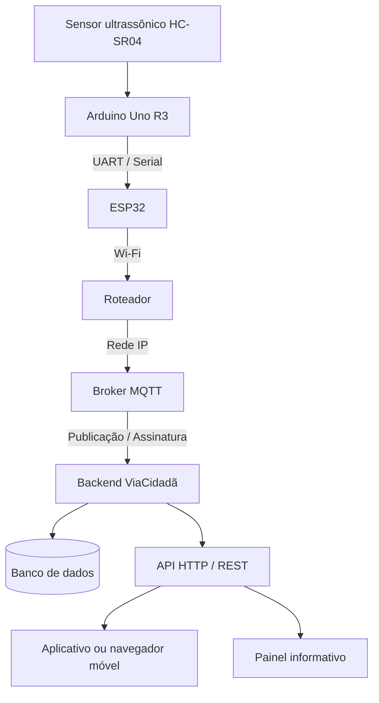

# Arquitetura de IoT e Comunicação em Rede — ViaCidadã

## 1. Objetivo

Este documento apresenta a arquitetura de comunicação proposta para o monitoramento de pontos de transporte público pelo ViaCidadã.

A solução utiliza sensores para coletar informações sobre a presença de veículos, processa os dados localmente e prevê seu encaminhamento por uma infraestrutura de rede até os serviços responsáveis por disponibilizar essas informações aos passageiros.

A arquitetura foi concebida para permitir a reutilização dos dispositivos em diferentes pontos de transporte, como paradas de ônibus e estações ferroviárias.

## 2. Visão geral da arquitetura

O fluxo de comunicação é composto por dispositivos de sensoriamento, processamento local, conectividade Wi-Fi, mensageria MQTT e serviços de aplicação.



## 3. Componentes e responsabilidades

### 3.1. Sensor ultrassônico HC-SR04

Responsável pela medição da distância entre o dispositivo e um objeto localizado à sua frente.

O sensor utiliza sinais ultrassônicos para calcular a distância com base no tempo de retorno do sinal refletido.

No protótipo, uma distância de até 250 cm é interpretada como presença detectada.

### 3.2. Arduino Uno R3

Responsável pelo processamento das informações coletadas pelo sensor.

Suas funções incluem:

- Realizar as leituras de distância.
- Comparar as medições com o limite configurado.
- Determinar os estados PRESENTE e AUSENTE.
- Controlar os LEDs indicadores.
- Organizar as informações em formato JSON.
- Disponibilizar atualizações na primeira leitura, em mudanças de estado e a cada 60 segundos.

### 3.3. ESP32

Atua como módulo de comunicação entre o circuito de monitoramento e a infraestrutura de rede.

Recebe os dados do Arduino por comunicação serial UART e utiliza sua conectividade Wi-Fi para encaminhar as informações ao broker MQTT.

Essa divisão permite manter o processamento do sensor separado das responsabilidades de comunicação em rede.

### 3.4. Roteador Wi-Fi

Fornece conectividade à rede IP, permitindo que o ESP32 alcance o broker MQTT e encaminhe as mensagens produzidas pelo dispositivo.

### 3.5. Broker MQTT

Responsável por receber, organizar e distribuir as mensagens dos dispositivos conectados.

A comunicação utiliza o modelo de publicação e assinatura (*publish/subscribe*), no qual os dispositivos publicam mensagens em tópicos e os serviços interessados recebem as atualizações correspondentes.

### 3.6. Backend ViaCidadã

Recebe as mensagens MQTT e processa as informações de monitoramento.

É responsável por organizar os estados dos pontos monitorados, disponibilizar informações para consultas e apoiar funcionalidades como alertas e alternativas de deslocamento.

### 3.7. Banco de dados

Armazena informações relevantes para consultas e acompanhamento do monitoramento, incluindo identificação dos dispositivos, pontos de transporte e histórico de estados.

### 3.8. API HTTP / REST

Disponibiliza as informações processadas pelo backend para as interfaces digitais da plataforma.

Permite que o aplicativo, navegador móvel e painéis informativos consultem os estados dos pontos monitorados.

## 4. Comunicação entre os dispositivos

### 4.1. Comunicação serial UART

A comunicação entre o Arduino Uno R3 e o ESP32 pode utilizar o protocolo UART.

As conexões devem respeitar a seguinte configuração:

| Arduino Uno | ESP32 |
|---|---|
| TX | RX |
| RX | TX |
| GND | GND |

**Atenção aos níveis lógicos:** o Arduino Uno trabalha com sinais de 5V, enquanto o ESP32 utiliza 3,3V. Portanto, a saída TX do Arduino deve utilizar um divisor de tensão ou conversor de nível lógico antes de chegar à entrada RX do ESP32.

O aterramento deve ser compartilhado entre os dois dispositivos.

### 4.2. Comunicação Wi-Fi

O ESP32 utiliza sua interface Wi-Fi para se conectar ao roteador e acessar a rede IP.

Essa conexão permite o envio das informações coletadas pelo dispositivo até os serviços responsáveis pelo processamento das mensagens.

### 4.3. Protocolo MQTT

O MQTT é utilizado para a troca de mensagens entre os dispositivos IoT e o backend.

Seu modelo de publicação e assinatura permite organizar a comunicação por tópicos, facilitando a identificação das informações de cada ponto monitorado.

Exemplo de tópico:

```text
viacidada/transporte/onibus/terminal-santana/status
```

Nesse exemplo, o tópico identifica as informações de status do monitoramento de ônibus no Terminal Santana.

## 5. Estrutura dos dados transmitidos

As informações são organizadas em JSON para facilitar a interpretação e integração entre os componentes.

Exemplo de mensagem:

```json
{
  "dispositivo": "VC-001",
  "parada": "Terminal Santana",
  "transporte": "ONIBUS",
  "presenca": true,
  "distancia_cm": 185.40
}
```

Descrição dos campos:

| Campo | Tipo | Finalidade |
|---|---|---|
| dispositivo | String | Identificação do equipamento |
| parada | String | Identificação do ponto monitorado |
| transporte | String | Categoria do transporte |
| presenca | Boolean | Estado identificado pelo sensor |
| distancia_cm | Number ou null | Distância medida em centímetros |

A estrutura permite que diferentes dispositivos utilizem o mesmo padrão de comunicação, alterando apenas suas identificações e configurações.

## 6. Fluxo completo de comunicação

O funcionamento da arquitetura pode ser dividido nas seguintes etapas:

1. O HC-SR04 realiza a medição da distância.
2. O Arduino Uno recebe a leitura e determina o estado de presença.
3. O Arduino organiza os dados em uma estrutura JSON.
4. O ESP32 recebe as informações pela comunicação UART.
5. O ESP32 encaminha os dados pela rede Wi-Fi.
6. O broker MQTT recebe a mensagem no tópico correspondente.
7. O backend ViaCidadã recebe e processa a atualização.
8. As informações relevantes são armazenadas e disponibilizadas por meio da API HTTP/REST.
9. As interfaces digitais apresentam o estado do ponto monitorado aos passageiros.

## 7. Aplicação na experiência do passageiro

Considere uma passageira que consulta o ViaCidadã pelo navegador de seu celular enquanto aguarda um ônibus no Terminal Santana.

O dispositivo de monitoramento identifica que o veículo permanece ausente por um período superior ao esperado. Essa informação é encaminhada à plataforma, que pode apresentar um alerta sobre a situação do transporte.

A passageira pode consultar o estado atualizado e selecionar a opção **“Recalcular minha rota”**, visualizando alternativas de deslocamento até seu destino.

Esse fluxo demonstra como a coleta de dados por sensores pode gerar informações úteis para a tomada de decisão dos usuários do transporte público.

## 8. Segurança e confiabilidade da comunicação

Para uma implementação em ambiente real, a arquitetura deve considerar mecanismos de proteção e continuidade operacional:

- Autenticação dos dispositivos e serviços.
- Comunicação MQTT protegida por TLS.
- Armazenamento seguro de credenciais.
- Reconexão automática em caso de perda de conectividade.
- Utilização de níveis de qualidade de serviço MQTT (QoS) adequados à importância das mensagens.
- Configuração de Last Will and Testament (LWT) para sinalizar desconexões inesperadas.
- Validação das mensagens recebidas pelo backend.

Esses mecanismos contribuem para a integridade das informações e a confiabilidade da comunicação.

## 9. Escalabilidade e reutilização

A arquitetura permite que múltiplos dispositivos sejam instalados em diferentes pontos de transporte.

Cada equipamento possui uma identificação própria e publica informações em tópicos associados à sua localização e categoria de transporte.

Exemplos:

```text
viacidada/transporte/onibus/terminal-santana/status
viacidada/transporte/trem/estacao-luz/status
```

Dessa forma, a mesma estrutura de comunicação pode atender a diferentes instalações, facilitando a expansão do monitoramento para novas paradas e estações.

## 10. Considerações técnicas

O protótipo utiliza Arduino Uno R3 e HC-SR04 para demonstrar a aquisição e o processamento local das informações.

A arquitetura de rede apresentada descreve a integração desses dados com ESP32, Wi-Fi, MQTT e os serviços da plataforma ViaCidadã.

A separação entre sensoriamento, processamento, comunicação e apresentação permite organizar a solução em módulos, facilitando sua manutenção, expansão e integração com outras funcionalidades.

A utilização de protocolos adequados a cada etapa — UART na comunicação entre microcontroladores, MQTT na mensageria IoT e HTTP/REST no acesso às informações da aplicação — estabelece um fluxo de comunicação estruturado e compatível com a proposta do projeto.
